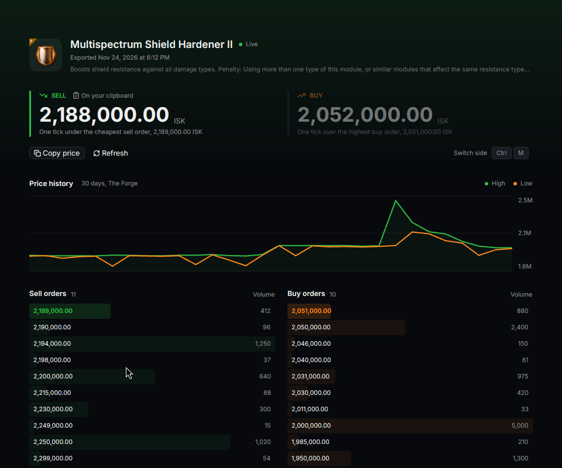

# Marketeer

A desktop market tool for EVE Online. It watches your market exports, works out the price that beats the best order, and puts it on your clipboard.



## What it does

- Watches the Marketlogs folder and shows a new export the moment the game writes it
- Undercuts the cheapest sell order or outbids the highest buy order by one tick (prices have four significant digits, so 12,340 moves by 10)
- Copies that price, ready to paste into the order window
- Switches between selling and buying with a global shortcut, `Ctrl+M` by default (`Cmd+M` on macOS), from inside the game
- Shows the item's 30 day price history in The Forge and the ten best orders on each side
- Prices a whole pasted list against Jita 4-4 (Bulk undercut)
- Updates itself from GitHub releases

## How to use it

1. Open the market in EVE Online and pick an item
2. Click Export to File at the bottom of the market window
3. Paste into the price field of your order

## Install

Get the latest build from the [releases](https://github.com/eve-marketeer/marketeer/releases) page: a `-setup.exe` for Windows, a `.dmg` for macOS (Apple silicon or Intel), an `.AppImage` or `.deb` for Linux.

Code is not signed. Windows SmartScreen asks once ("More info", "Run anyway"). On macOS the first start is refused; allow it under System Settings, Privacy & Security, "Open Anyway".

The installed exe, the `.app` and the AppImage update themselves. A `.deb` install is pointed at the release page instead.

## Where it looks

The export folder is found on its own, the first of these that exists:

- `Documents/EVE/logs/Marketlogs`
- `OneDrive/Documents/EVE/logs/Marketlogs`
- the macOS client's `Library/Application Support/EVE Online/p_drive/User/My Documents/EVE/logs/Marketlogs`
- Steam's Proton prefix for EVE on Linux

Set another one in Settings. Settings are kept in `marketeer/config.toml` in the system's config folder.

On Linux the global shortcut goes through X11. Under Wayland it fires while an X11 window has focus, which EVE under Proton is.

## Building

```sh
cargo run --release
```

It is a [GPUI](https://www.gpui.rs) app (through `gpui-kit`). Linux needs the usual libraries: on Debian or Ubuntu, `libxkbcommon-dev libxkbcommon-x11-dev libwayland-dev libxcb1-dev libfontconfig-dev libfreetype-dev libvulkan-dev`.

`cargo test -- --ignored` also runs the tests that talk to ESI.

## Releasing

Bump `version` in `Cargo.toml`, merge, then push that commit to the `release` branch. CI (`.github/workflows/release.yml`) builds and packages every platform with cargo-packager and creates a draft release `marketeer-v<version>`. Publishing the draft is what offers the update to everyone: the app reads `latest.json` from the latest published release.

Update bundles are signed. The key pair lives in the repository's `UPDATER_PRIVATE_KEY` and `UPDATER_PRIVATE_KEY_PASSWORD` secrets and the `UPDATER_PUBKEY` variable (`cargo packager signer generate` makes one). Losing the private key means existing installs can no longer update themselves, so keep a copy somewhere safe.

## License

MIT. Inter is bundled under the OFL (`assets/fonts/OFL-Inter.txt`).
